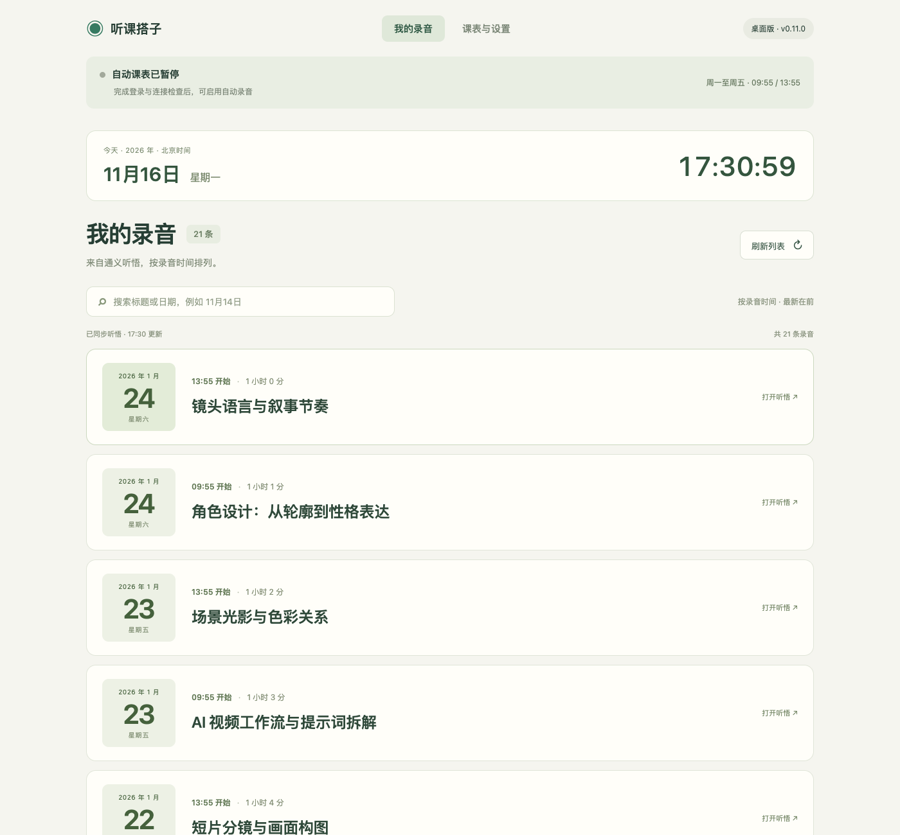
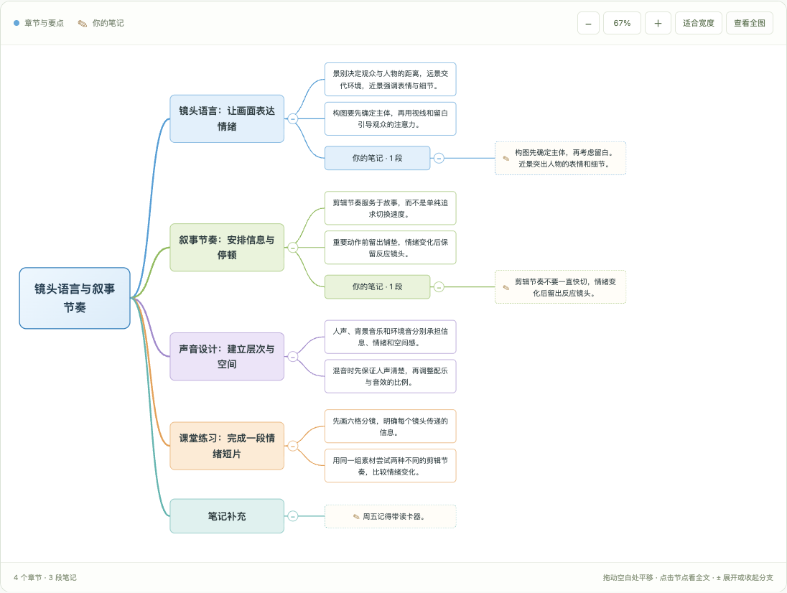

# 听课搭子 · 通义听悟课堂录音助手

一个在 macOS 上运行的小工具：按工作日课表自动录制本地麦克风音频，下课提醒你在 App 中手动结束，然后上传通义听悟整理。复用 Chrome 中的登录状态，上传成功后仍保留本地音频。



## v0.12 本地录音与上传

- 参考 [TingwuMeetingAgent](https://github.com/faceair/TingwuMeetingAgent) 的本地录音、结束后上传流程，保留原有课表、命名和大纲功能。许可证见 `THIRD_PARTY_NOTICES.md`。
- 独立的 macOS 录音进程使用系统麦克风，持续写入本机 WAV（16 kHz、单声道、16 bit，约每小时 115 MB）。听悟网页结束、浏览器掉线或 Node 服务重启不会向它发送停止操作。
- 首页显示当前录音时长；下课由你点击「结束并上传」。12:10 / 18:10 只发送通知，不会停止录音。
- 上传使用分片与进度记录，失败保留文件并退避重试；重启后继续同一上传任务，收到对象存储与听悟确认后标记上传成功。创建远端任务结果不明确时暂停并要求检查，避免默默新建重复记录。临时上传凭证过期时需手动上传本地文件。
- 录音结束时先完成本地保存。上传成功后仍保留音频；首页展开「本地音频与上传记录」可下载。没有自动删除音频的功能，需要自行管理磁盘空间。
- 本地音频在 `~/Library/Application Support/TingwuClassAssistant/data/local/Recordings/`。上传队列含短期 OSS 凭证，仅保存在本机权限 600 的文件，不返回界面或写入日志；密码和 Chrome Cookie 不导出。
- 新录音器需单独授权系统麦克风。首次打开首页点击「授权麦克风」，在系统提示中允许。听悟登录和 Chrome 脚本权限仅用于上传、命名及大纲，不再阻塞本地录音开始。
- 本地录音可在没有网络时进行；联网并恢复听悟登录后再上传。电脑关机、系统休眠、合盖、磁盘满或麦克风故障仍会影响录音。录音进程意外退出时保留已写入音频并尝试修复 WAV 长度，不宣称补回已经漏录的内容。
- 上传后沿用原录音开始日期和时间自动命名，转写与思维导图在听悟处理完成后出现。结束前不提供听悟实时转写和对应笔记区。

以下为历史版本记录；v0.12 已替换网页自动点击录音流程。

## v0.11.2 课内录音状态检查

- 开始录音后每 30 秒后台复查，覆盖上午到 12:00、下午到 18:00；不再在上课一分钟后停止检查。
- 听悟显示超时、网络异常或额度提示时，记录提示原文和页面计时，并提示检查；计时仍在增加也不掩盖异常。
- 同一持续异常只提醒一次，恢复后更新状态；暂停和结束仍由用户操作，程序不自动结束、刷新或重开录音。
- 这项修复补齐中途异常检测，不代表已经解决听悟服务端的提前结束，也没有加入本地备份录音。

## v0.11.1 后台任务自动恢复

- 独立的 macOS 后台检查每 30 秒核对服务。课表已启用时，如果主任务被移除，会重新加载；服务连续两次没有响应或课表心跳停止时，会重启本工具服务。
- 检查程序只管理本工具，不操作 Chrome、停止录音或更改课表。已确认的课次保存在本机，服务恢复后保留已有录音，不重复开启。
- 暂停课表时不自动恢复；明确禁用系统后台项时也保留禁用状态。此机制依赖 macOS 仍允许后台检查任务运行，不能绕过系统休眠、登录失效或用户禁用。
- App 失去后台连接时，会明确显示「后台连接中断」，不再沿用绿色启用状态。服务恢复后更新连接信息，已打开的界面可以继续使用。
- 恢复记录仅保存在本机的 `data/service-guard.json` 和 `logs/service-guard.log`。

## 清晰的录音首页

- 左侧固定「我的录音 / 课表与设置」两个入口；日期、星期与实时时钟合并在页头。
- 录音按日期分组，同一天的课堂集中显示。标题、开始时间与时长一眼可见，点击标题或「查看大纲」进入思维导图、笔记与原文；「听悟回放」单独标明。
- 首页用上午、下午两栏显示计划时间和启动确认状态，异常单独提示。过去的启动确认不表示麦克风当前仍在录音。
- 设置先显示课表和保存后自动改标题；命名记录、连接权限、录音测试和运行日志按需展开。

## v0.11 课前启动与录音复查

- 下午默认改为 13:45 检查连接、13:50 自动开始，为 14:00 上课预留十分钟；错过计划时刻后，开盖恢复运行会继续补启动。
- 区分「程序自动开启」和「检测到已有录音」；已有录音的计时增长不再被写成自动点击成功。只有实际点击开始且新录音计时吻合，才标记为自动开启。
- 确认开始后，每 30 秒复查一次录音计时，持续到本节课结束。13:58 仍未确认时提前通知并继续重试；上午同理在 09:58 提醒。
- 首页显示最近一次确认的来源和复查时间。暂停、停止或计时不动会提示检查，但不会重复创建录音或替你恢复已暂停的录音。
- 升级保留已有课表；已有用户可在「课表与设置」把下午开始时间调整为 13:50。

## v0.10 录音大纲与听悟笔记

- 点击录音标题直接进入 App 内的详情页；放大显示主题，提供「思维导图 / 内容大纲 / 听悟笔记 / 转写原文」四种视图。
- 思维导图从左向右分层展开，按章节使用不同颜色的曲线与圆角节点；支持拖动、缩放、查看全图和分支展开收起。笔记以 ✎ 标记，长节点点击可查看全文。
- 读取听悟全文概要与全部章节，不截取前几章。你的听悟笔记按时间标记或关键词归入相关章节，保留原文与来源；无法确定对应关系的笔记放在「笔记补充」，不会丢弃。
- 没有笔记时根据录音整理；听悟暂未生成章节时，覆盖完整转写分段摘录，并明确标注为摘录。图像和附件笔记暂不识别文字，需在听悟查看原件。
- 修改听悟笔记后可点击「重新整理」。读取失败会保留本机上次整理，并区分「没有笔记」和「笔记读取失败」。详情缓存仅保存在本机 `data/recording-details/`，不导出登录凭据、不下载音频，也不接入额外的 AI 服务。
- 自动录音优先于内容整理；详情读取不切换 Chrome 的页面、焦点或鼠标。新请求和缓存读写沿用本机来源与令牌校验。



## v0.9 录音列表首页

- 打开桌面 App 默认进入「我的录音」，按时间倒序展示听悟的全部已保存记录，不受命名历史条数限制。
- 每条记录单独展示放大的日期、标题，以及开始时间和时长；点击标题在 App 内查看大纲、笔记与原文，右侧保留听悟回放入口。
- 首页显示今天的月日、星期和实时时分秒，按北京时间每秒更新，跨午夜自动切换日期。
- 支持按标题或日期搜索、手动刷新；上次同步的列表保存在本机，网络暂时不可用时仍可查看。
- 课表、自动命名和测试入口集中到「课表与设置」。自动录音优先，列表同步不会切换听悟页面或操作鼠标。

## v0.8 自动命名补漏

- 每分钟核对听悟已保存记录，以录音编号关联任务，保存后返回首页、关掉详情页或服务重启也可以恢复。
- 支持中文日期标题，修复页面尚未加载时误把「首页」当作原标题的问题。
- 在已登录的听悟标签页内读取概要并提交标题，随后从听悟重新读取确认；不切换窗口、不刷新你正在看的页面。
- 网络失败后先核对当前标题：已保存则补记成功，仍是原标题才退避重试；你手动修改的标题会保留。
- 内容生成较慢时持续等待，空录音和有效内容很少的录音会明确标注。首次启用也会补查未命名的旧记录。

## v0.7 自动启动修复

- 固定连接日常 Chrome 的进程，避免误连其他任务的无头测试浏览器。
- 自动启动使用后台网页脚本，不激活浏览器、不切换前台窗口、不移动鼠标。需要 Chrome 开启「允许 Apple 事件中的 JavaScript」。
- 只有核对录音计时持续增加，才把本节课标记为成功；暂停或未确认的会话不会被当作成功。
- 课内失败会重试，开机或恢复连接后可补启动；上午 12:00、下午 18:00 后不再补开。确认成功后不会因使用者手动结束而再次启动。
- 录音启动优先于自动命名；运行状态区显示未确认和失败原因。失败用通知提示，保留原有 12:10 / 18:10 下课询问。
- 请保留一个已登录的听悟标签页，放在后台即可。Chrome 正在运行但没有听悟标签页时，程序会提示补开页面。

## 自动命名

录音结束保存后，使用听悟已有的全文概要、章节标题与关键词提炼主题，将听悟中的记录标题命名为：

`2026-01-12｜10:00｜项目规划与任务拆解`

日期和时间优先取自原录音标题；标题缺少时间时可使用听悟记录的原始时间，不使用处理时刻或计划上课时间。主题优先提取全文概要的主体；没有可用概括时，使用章节标题作为候选。自动命名不调用新的大模型 API，也不改写听悟的大纲。

- 自动命名默认关闭。检查效果后，点击「启用自动命名」即可自动处理后续录音，与自动课表开关独立。
- 每分钟核对已保存录音，每 15 秒处理一条待命名任务。相同保存链接只建立一个任务；提交后重新读取标题确认保存。
- 请保留一个已登录的听悟标签页，停在首页也能命名。整个过程在后台完成，不切换窗口或刷新页面。
- 本机记录原名、新名和处理状态。改名之前先记录提交意图；中断后先读取现有标题，再决定补记成功或重试，最多退避到 15 分钟。
- 「补查漏改记录」立即扫描历史默认标题；启用自动命名后会处理这些任务。「重新检查」只为对应记录生成候选，「采用这个标题」提交候选。手动起的自定义标题不会被自动覆盖。
- [打开命名演示文件](preview/自动命名演示.html)（下载后用浏览器打开），可编辑示例标题并切换完成、内容不足等状态。使用虚构课程，所有操作只改变演示数据。

v0.8 已在真实账号完成历史录音补改及逐条重新读取确认，使用与自动命名相同的提交路径。后台请求复用浏览器登录状态，不导出 Cookie，也不需要另填 API 密钥；后续处理仍依赖听悟登录、Chrome 后台脚本权限与网站接口可用。

## 更新到最新版

在已有源码目录运行：

```sh
git pull --ff-only
python3 install-desktop.py
```

升级保留本机设置；音频、录音标题记录、登录信息与本机审查文件不包含在仓库中。

## 默认课表

周一至周五，北京时间；首次安装默认暂停，需要检查连接后手动启用。

| 时间 | 动作 |
| --- | --- |
| 09:50 | 检查本地录音器与麦克风授权 |
| 09:55 | 自动开始本地录音 |
| 12:10 | 询问是否结束，由本人手动结束 |
| 13:45 | 检查本地录音器与麦克风授权 |
| 13:50 | 自动开始本地录音 |
| 18:10 | 询问是否结束，由本人手动结束 |

开始时间和提醒时间可在界面修改，预检提前五分钟。周末不运行。桌面服务每 2 秒检查课表：09:55 时电脑可用就开始；若当时合盖或休眠，09:55 之后恢复运行会补启动，不会因为错过计划时刻而跳过整节课。默认下午 13:50 同理。

从计划开始至上课后 5 分钟，未确认成功的尝试按至少 5 秒间隔重试；其后恢复 30 秒间隔。在途启动不会并发重复，麦克风准备可能需要额外时间。恰好 10:00 才开盖不能保证 10:00:00 已录上，程序会尽快启动并核对计时。上午 12:00、下午 18:00 后停止补开，仍需本人结束已开始的录音。

## 安装

需要 macOS、Google Chrome、Node.js、Python 3 和 Xcode Command Line Tools（用于编译 Swift 辅助功能组件）。

```sh
git clone https://github.com/tangyi2300-ctrl/tingwu-class-assistant.git
cd tingwu-class-assistant
npm ci
python3 install-desktop.py
```

安装完成后，双击桌面的 **听课搭子.app**：

1. 在首页点击「授权麦克风」，允许「听课搭子录音」使用系统麦克风。
2. 在常用 Chrome 中登录[通义听悟](https://tingwu.aliyun.com/)，保留一个已登录标签页。
3. 在 Chrome「显示 → 开发者」中开启「允许 Apple 事件中的 JavaScript」。用于上传和读取听悟资料；若系统询问是否允许后台控制 Chrome，也需允许。
4. 点击首页「开始录音」，确认本地计时增加，随后亲自点击「结束并上传」检查完整流程。
5. 点击「启用课表」。以后登录 macOS 时后台自动运行，关闭控制页面不影响计划。
6. 点击「启用自动命名」。升级安装会保留原有课表和自动命名开关。

本地录音不依赖 Chrome、听悟登录或网络；上传与整理需要 Chrome 中已有一个听悟标签页。程序不会修改浏览器配置文件绕过权限。

## 运行条件

- 电脑保持开机、开盖、已登录，建议接电。录音期间防止因闲置自动休眠；可锁屏使用，新版仍应在自己的电脑上验证。锁屏不等于系统休眠，关机、合盖或系统休眠仍会影响录音。
- 保存后自动命名等待听悟概要或章节；若两项均明确返回“文字过短”，会使用「原日期｜原开始时间｜内容不足待补充主题」，避免短录音一直等待。仍在生成或生成失败时继续重试，不猜测课程主题。
- 麦克风权限与磁盘空间需要有效。上传和整理另需 Chrome、听悟登录、网络与账号额度。登录失效时会提醒处理，程序不能代替验证码或身份验证。
- 已有本地录音时使用现有录音，不重复启动；手动结束后不会因课表检查再次开启。
- **定时任务不会结束录音。** 只有你在听课搭子点击「结束并上传」才停止本地录音。下课通知仅提醒。
- 暂停课表会取消后续自动动作和防闲置休眠，不会停止已开始的录音。

## 本机数据

- 桌面入口：`~/Desktop/听课搭子.app`
- 程序、独立 Node 运行时与设置：`~/Library/Application Support/TingwuClassAssistant/`
- 后台启动项：`~/Library/LaunchAgents/com.tangyi.tingwuclassassistant.agent.plist`
- 自动恢复检查：`~/Library/LaunchAgents/com.tangyi.tingwuclassassistant.guard.plist`
- 控制界面：`http://127.0.0.1:18766/`

控制服务只监听本机，修改请求检查来源及随机令牌。本地录音由独立麦克风进程写入 WAV，用户结束后上传听悟，原音频保留。密码和 Cookie 留在 Chrome 中，不随源码发布。

重新运行安装程序会保留本机课表设置。停用时先在界面暂停课表，再运行：

```sh
launchctl bootout "gui/$(id -u)" "$HOME/Library/LaunchAgents/com.tangyi.tingwuclassassistant.guard.plist"
launchctl bootout "gui/$(id -u)" "$HOME/Library/LaunchAgents/com.tangyi.tingwuclassassistant.agent.plist"
```

## 开发与验证

```sh
npm ci
npm test
npm run test:desktop
npm run test:background
npm run test:preview
```

自动化测试覆盖工作日补启动、失败持久化、重启恢复、自动点击与已有录音的来源区分、整节课持续复查、提前失败提醒、结束后不重复启动、命名优先级、中文日期、保存记录补查、标题冲突保护与保存结果核对。桌面集成测试使用独立端口 18767，验证界面和本机请求保护，不采集真实音频。

v0.7 已完成后台页面点击、计时进展、无头浏览器隔离和另一工作页面保持不变的自动化验收；在真实账号开启 Chrome 后台脚本权限后，也通过了已安装服务的后台启动测试，确认实际录音计时持续增加。尚未观察未来计划时刻或整堂课持续录音，这不代表已验证所有 Chrome/macOS 版本，也不保证未来网站界面变化后仍可使用。

`desktop/` 为桌面服务和界面，`native/` 为原生麦克风录音器和兼容的点击组件，`tests/` 为测试。`extension/` 保留早期 Chrome 扩展实现，桌面版不要求安装扩展，请勿同时启用两套课表。`preview/` 中静态预览仅用于查看界面。

本项目为独立制作的辅助工具，与通义听悟官方无隶属关系。
