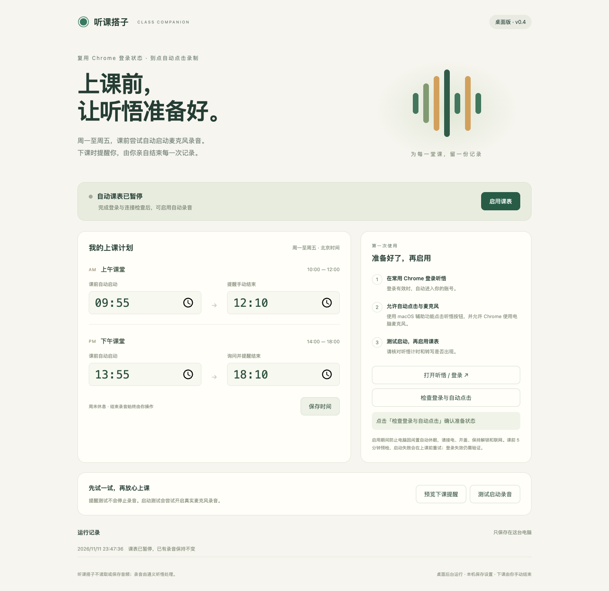

# 听课搭子 · 通义听悟课堂录音助手

一个在 macOS 上运行的小工具：按工作日课表打开通义听悟、点击开始麦克风录音，并在下课时提醒使用者亲自结束。复用 Chrome 中的登录状态。



## 默认课表

周一至周五，北京时间；首次安装默认暂停，需要检查连接后手动启用。

| 时间 | 动作 |
| --- | --- |
| 09:50 | 检查上午录音所需的听悟连接和登录状态 |
| 09:55 | 自动点击开始录音 |
| 12:10 | 询问是否结束，由本人手动结束 |
| 13:50 | 检查下午录音所需的听悟连接和登录状态 |
| 13:55 | 自动点击开始录音 |
| 18:10 | 询问是否结束，由本人手动结束 |

开始时间和提醒时间可在界面修改，预检提前五分钟。周末不运行。启动失败会在课前重试；默认课表下，上午 09:59:45、下午 13:59:45 后不再发起新的启动点击。

## 安装

需要 macOS、Google Chrome、Node.js、Python 3 和 Xcode Command Line Tools（用于编译 Swift 辅助功能组件）。

```sh
git clone https://github.com/tangyi2300-ctrl/tingwu-class-assistant.git
cd tingwu-class-assistant
python3 install-desktop.py
```

安装完成后，双击桌面的 **听课搭子.app**：

1. 在常用 Chrome 中登录[通义听悟](https://tingwu.aliyun.com/)，并允许网站使用麦克风。
2. 在 macOS 系统设置中允许后台运行程序 `node` 使用辅助功能；若系统询问是否允许控制 Chrome，也需允许。
3. 点击「打开听悟 / 登录」及「检查登录与自动点击」。
4. 点击「测试启动录音」，确认听悟计时、转写和麦克风正常，然后亲自结束测试录音。
5. 点击「启用课表」。以后登录 macOS 时后台会自动运行，关闭控制页面不影响计划。

桌面版使用 macOS 辅助功能点击普通网页按钮，不要求开启 Chrome 的 Apple 事件 JavaScript 选项。

程序优先复用已打开的听悟标签页。Chrome 未运行时默认打开 Default 配置；多配置用户应提前打开已登录的听悟窗口，或在本机数据目录的 `session-preferences.json` 中指定 `profileDirectory`（如 `Profile 1`）。该文件仅存本机，不应上传。

## 运行条件

- 电脑保持开机、开盖、登录和解锁、接电联网。启用期间会防止因闲置自动休眠；关机、合盖和锁屏状态下无法保证自动操作。
- Chrome、听悟登录、麦克风和录音额度需要有效。登录失效时会提醒处理，程序不能代替验证码或身份验证。
- 已有录音时保留现有会话，不重复创建；如果录音处于暂停状态，会提醒本人恢复。
- **程序从不点击结束或停止录音。** 下课弹窗仅提醒并提供前往听悟的入口。
- 暂停课表会取消后续自动动作和防闲置休眠，不会停止已开始的录音。

## 本机数据

- 桌面入口：`~/Desktop/听课搭子.app`
- 程序、独立 Node 运行时与设置：`~/Library/Application Support/TingwuClassAssistant/`
- 后台启动项：`~/Library/LaunchAgents/com.tangyi.tingwuclassassistant.agent.plist`
- 控制界面：`http://127.0.0.1:18766/`

控制服务只监听本机，修改请求检查来源及随机令牌。工具不采集、保存或上传音频，录音由听悟处理。密码和 Cookie 留在 Chrome 中，不随源码发布。

重新运行安装程序会保留本机课表设置。停用时先在界面暂停课表，再运行：

```sh
launchctl bootout "gui/$(id -u)" "$HOME/Library/LaunchAgents/com.tangyi.tingwuclassassistant.agent.plist"
```

## 开发与验证

```sh
npm ci
npm test
npm run test:desktop
```

23 项自动化测试覆盖课表、课前重试与截止时间、已有录音识别及早期扩展逻辑。桌面集成测试使用独立端口 18767，验证界面和本机请求保护，不采集真实音频。

已在 macOS 上完成真实录音启动、后台权限、手动结束后的状态识别、后台重启后课表持久化及防闲置休眠检查。这不代表已验证所有 Chrome/macOS 版本，也不保证未来网站界面变化后仍可使用。

`desktop/` 为桌面服务和界面，`native/` 为原生点击组件，`tests/` 为测试。`extension/` 保留早期 Chrome 扩展实现，桌面版不要求安装扩展，请勿同时启用两套课表。`preview/` 中静态预览仅用于查看界面。

本项目为独立制作的辅助工具，与通义听悟官方无隶属关系。
