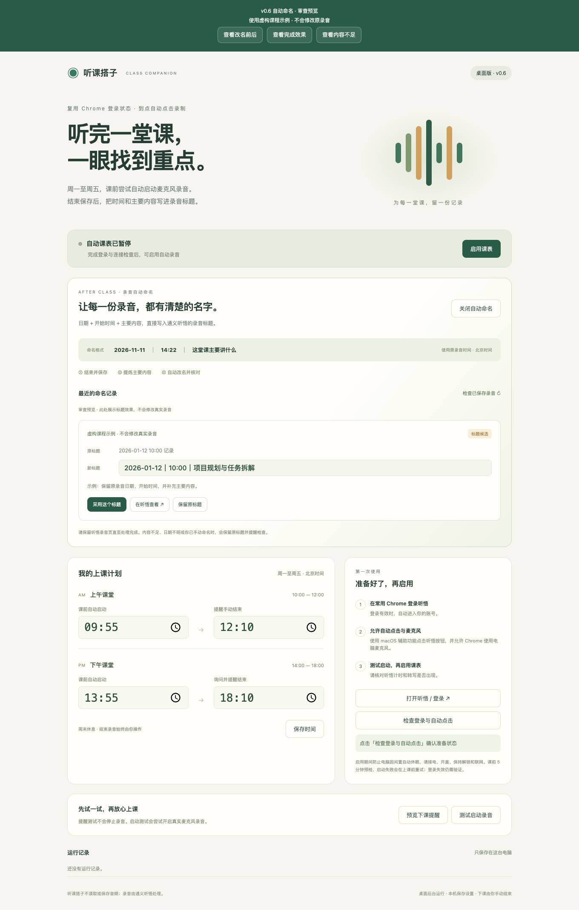

# 听课搭子 · 通义听悟课堂录音助手

一个在 macOS 上运行的小工具：按工作日课表打开通义听悟、点击开始麦克风录音，并在下课时提醒使用者亲自结束。复用 Chrome 中的登录状态。



## v0.8 自动命名补漏

- 每分钟核对听悟已保存记录，以录音编号关联任务，保存后返回首页、关掉详情页或服务重启也可以恢复。
- 支持中文日期标题，修复页面尚未加载时误把「首页」当作原标题的问题。
- 在已登录的听悟标签页内读取概要并提交标题，随后从听悟重新读取确认；不切换窗口、不刷新你正在看的页面。
- 网络失败后先核对当前标题：已保存则补记成功，仍是原标题才退避重试；你手动修改的标题会保留。
- 内容生成较慢时持续等待，空录音和有效内容很少的录音会明确标注。首次启用也会补查未命名的旧记录。

## v0.7 自动启动修复

- 固定连接日常 Chrome 的进程，避免误连其他任务的无头测试浏览器。
- 自动启动使用后台网页脚本，不激活浏览器、不切换前台窗口、不移动鼠标。需要 Chrome 开启「允许 Apple 事件中的 JavaScript」。
- 只有核对录音计时持续增加，才把本节课标记为成功；暂停或未确认的会话不会被当作成功。
- 课内失败会重试，开机或恢复连接后可补启动；上午 12:00、下午 18:00 后不再补开。确认成功后不会因使用者手动结束而再次启动。
- 录音启动优先于自动命名；运行状态区显示未确认和失败原因。失败用通知提示，保留原有 12:10 / 18:10 下课询问。
- 请保留一个已登录的听悟标签页，放在后台即可。Chrome 正在运行但没有听悟标签页时，程序会提示补开页面。

## 自动命名

录音结束保存后，使用听悟已有的全文概要、章节标题与关键词提炼主题，将听悟中的记录标题命名为：

`2026-01-12｜10:00｜项目规划与任务拆解`

日期和时间优先取自原录音标题；标题缺少时间时可使用听悟记录的原始时间，不使用处理时刻或计划上课时间。主题优先提取全文概要的主体；没有可用概括时，使用章节标题作为候选。没有新接入大模型 API，也不会重新生成大纲。

- 自动命名默认关闭。检查效果后，点击「启用自动命名」即可自动处理后续录音，与自动课表开关独立。
- 每分钟核对已保存录音，每 15 秒处理一条待命名任务。相同保存链接只建立一个任务；提交后重新读取标题确认保存。
- 请保留一个已登录的听悟标签页，停在首页也能命名。整个过程在后台完成，不切换窗口或刷新页面。
- 本机记录原名、新名和处理状态。改名之前先记录提交意图；中断后先读取现有标题，再决定补记成功或重试，最多退避到 15 分钟。
- 「补查漏改记录」立即扫描历史默认标题；启用自动命名后会处理这些任务。「重新检查」只为对应记录生成候选，「采用这个标题」提交候选。手动起的自定义标题不会被自动覆盖。
- [打开命名演示文件](preview/自动命名演示.html)（下载后用浏览器打开），可编辑示例标题并切换完成、内容不足等状态。使用虚构课程，所有操作只改变演示数据。

v0.8 已在真实账号完成历史录音补改及逐条重新读取确认，使用与自动命名相同的提交路径。后台请求复用浏览器登录状态，不导出 Cookie，也不需要另填 API 密钥；后续处理仍依赖听悟登录、Chrome 后台脚本权限与网站接口可用。

## 更新到最新版

在已有源码目录运行：

```sh
git pull --ff-only
python3 install-desktop.py
```

升级保留本机设置；音频、录音标题记录、登录信息与本机审查文件不包含在仓库中。

## 默认课表

周一至周五，北京时间；首次安装默认暂停，需要检查连接后手动启用。

| 时间 | 动作 |
| --- | --- |
| 09:50 | 检查上午录音所需的听悟连接和登录状态 |
| 09:55 | 自动点击开始录音 |
| 12:10 | 询问是否结束，由本人手动结束 |
| 13:50 | 检查下午录音所需的听悟连接和登录状态 |
| 13:55 | 自动点击开始录音 |
| 18:10 | 询问是否结束，由本人手动结束 |

开始时间和提醒时间可在界面修改，预检提前五分钟。周末不运行。桌面服务每 2 秒检查课表：09:55 时电脑可用就开始；若当时合盖或休眠，09:55 之后恢复运行会补启动，不会因为错过计划时刻而跳过整节课。默认下午 13:55 同理。

从计划开始至上课后 5 分钟，未确认成功的尝试按至少 5 秒间隔重试；其后恢复 30 秒间隔。在途启动不会并发重复，网页加载或连接可能需要更长时间。恰好 10:00 才开盖不能保证 10:00:00 已录上，程序会尽快启动并核对计时。上午 12:00、下午 18:00 后停止补开，仍需本人结束已开始的录音。

## 安装

需要 macOS、Google Chrome、Node.js、Python 3 和 Xcode Command Line Tools（用于编译 Swift 辅助功能组件）。

```sh
git clone https://github.com/tangyi2300-ctrl/tingwu-class-assistant.git
cd tingwu-class-assistant
python3 install-desktop.py
```

安装完成后，双击桌面的 **听课搭子.app**：

1. 在常用 Chrome 中登录[通义听悟](https://tingwu.aliyun.com/)，并允许网站使用麦克风。
2. 在 Chrome「显示 → 开发者」中亲自开启「允许 Apple 事件中的 JavaScript」。若 macOS 询问是否允许后台控制 Chrome，也需允许。辅助功能只用于只读状态回退。
3. 点击「打开听悟 / 登录」及「检查登录与自动点击」。
4. 点击「测试启动录音」，确认听悟计时、转写和麦克风正常，然后亲自结束测试录音。
5. 点击「启用课表」。以后登录 macOS 时后台会自动运行，关闭控制页面不影响计划。
6. 点击「启用自动命名」。录音结束保存后保留一个听悟标签页，等待标题更新。升级安装会保留现有课表和自动命名开关。

静默自动启动通过网页后台脚本执行，因此 Chrome 的 Apple 事件 JavaScript 选项必须开启。程序不会通过修改浏览器配置文件绕过这个权限。

程序优先复用已打开的听悟标签页。Chrome 未运行时默认打开 Default 配置；多配置用户应提前打开已登录的听悟窗口，或在本机数据目录的 `session-preferences.json` 中指定 `profileDirectory`（如 `Profile 1`）。该文件仅存本机，不应上传。

## 运行条件

- 电脑保持开机、开盖、登录、接电联网。启用期间会防止因闲置自动休眠。当前环境已实测锁屏后可后台启动录音、收到语音并读写标题；其他电脑请先实测。锁屏不等于系统休眠，关机、合盖或系统休眠仍会影响录音。
- 保存后自动命名等待听悟概要或章节；若两项均明确返回“文字过短”，会使用「原日期｜原开始时间｜内容不足待补充主题」，避免短录音一直等待。仍在生成或生成失败时继续重试，不猜测课程主题。
- Chrome、听悟登录、麦克风和录音额度需要有效。登录失效时会提醒处理，程序不能代替验证码或身份验证。
- 已有录音时保留现有会话，不重复创建；如果录音处于暂停状态，会提醒本人恢复。
- **程序从不点击结束或停止录音。** 下课弹窗仅提醒并提供前往听悟的入口。
- 暂停课表会取消后续自动动作和防闲置休眠，不会停止已开始的录音。

## 本机数据

- 桌面入口：`~/Desktop/听课搭子.app`
- 程序、独立 Node 运行时与设置：`~/Library/Application Support/TingwuClassAssistant/`
- 后台启动项：`~/Library/LaunchAgents/com.tangyi.tingwuclassassistant.agent.plist`
- 控制界面：`http://127.0.0.1:18766/`

控制服务只监听本机，修改请求检查来源及随机令牌。工具不采集、保存或上传音频，录音由听悟处理。密码和 Cookie 留在 Chrome 中，不随源码发布。

重新运行安装程序会保留本机课表设置。停用时先在界面暂停课表，再运行：

```sh
launchctl bootout "gui/$(id -u)" "$HOME/Library/LaunchAgents/com.tangyi.tingwuclassassistant.agent.plist"
```

## 开发与验证

```sh
npm ci
npm test
npm run test:desktop
npm run test:background
npm run test:preview
```

61 项自动化测试覆盖工作日补启动、失败持久化、重启恢复、录音计时确认、结束后不重复启动、命名优先级、中文日期、保存记录补查、标题冲突保护与保存结果核对。桌面集成测试使用独立端口 18767，验证界面和本机请求保护，不采集真实音频。

v0.7 已完成后台页面点击、计时进展、无头浏览器隔离和另一工作页面保持不变的自动化验收；在真实账号开启 Chrome 后台脚本权限后，也通过了已安装服务的后台启动测试，确认实际录音计时持续增加。尚未观察未来计划时刻或整堂课持续录音，这不代表已验证所有 Chrome/macOS 版本，也不保证未来网站界面变化后仍可使用。

`desktop/` 为桌面服务和界面，`native/` 为原生点击组件，`tests/` 为测试。`extension/` 保留早期 Chrome 扩展实现，桌面版不要求安装扩展，请勿同时启用两套课表。`preview/` 中静态预览仅用于查看界面。

本项目为独立制作的辅助工具，与通义听悟官方无隶属关系。
